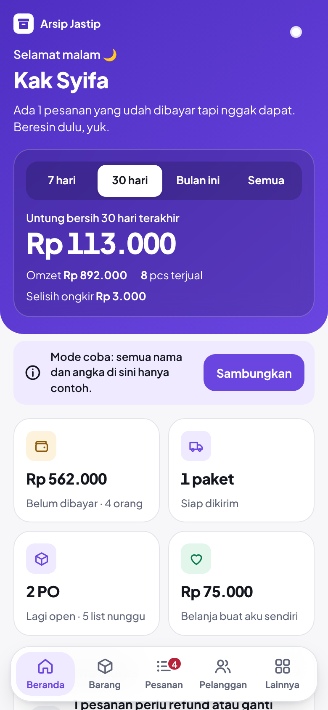
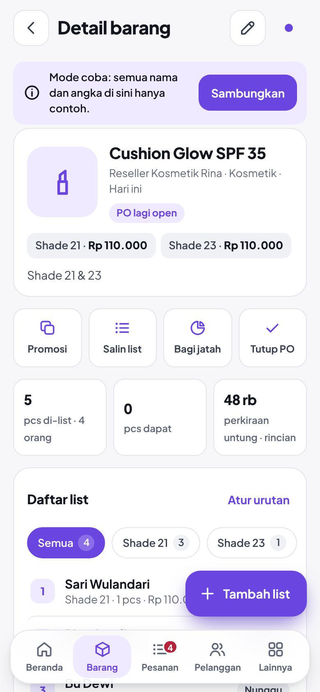

# Arsip Jastip

Aplikasi pencatat bisnis jastip yang dipasang di layar utama HP. Catat PO dari supplier, siapa saja yang list, bagi jatah, tagih lewat WhatsApp, sampai resi kiriman. Datanya tersimpan di Google Sheet milikmu sendiri.

Dibuat oleh [@ahmddzul](https://instagram.com/ahmddzul) untuk dipakai pribadi. Kamu boleh memakainya dengan membuat salinan sendiri, gratis.

<p>
  
  
</p>

*Gambar di atas memakai data contoh dari mode coba.*

---

## Isi

- [Fitur](#fitur)
- [Cara kerja dan keamanan data](#cara-kerja-dan-keamanan-data)
- [Yang kamu butuhkan](#yang-kamu-butuhkan)
- [Pasang untuk dirimu sendiri (5 langkah)](#pasang-untuk-dirimu-sendiri-5-langkah)
- [Menyambungkan HP kedua](#menyambungkan-hp-kedua)
- [Memperbarui ke versi baru](#memperbarui-ke-versi-baru)
- [Kalau ada masalah](#kalau-ada-masalah)

---

## Fitur

| Menu | Yang bisa dilakukan |
|---|---|
| Beranda | Untung bersih dan pesanan masuk (termasuk yang belum bayar) per 7 hari, 30 hari, bulan, tahun, atau semua, tagihan yang belum dibayar, paket siap kirim, daftar hal yang perlu diurus, grafik untung, barang paling cuan, pelanggan setia, peluang dapat per supplier |
| Barang | Catat PO dengan varian dan harga berbeda, diskon beli banyak, foto opsional, teks promosi otomatis, salin list untuk grup, bagi jatah sesuai urutan list, stok dan barang sisa, rincian untung (termasuk bagian ongkir dari supplier) |
| Pesanan | Filter Nunggu kabar, Belum bayar, Siap kirim, Dikirim, Perlu refund, Buat aku, Batal. Tagih via WhatsApp dan tandai lunas sekali ketuk |
| Pelanggan | Riwayat belanja, sapaan (Kak, Mas, Mbak, Bu, Pak), nomor WA, alamat, tagihan, resi |
| Lainnya | Kalimat penyemangat saat aplikasi dibuka (bisa disembunyikan), kiriman, supplier dengan catatan ongkir dari supplier (mengurangi untung), FAQ, pengaturan, template pesan WA yang bisa diubah, mode gelap, 6 warna tema pastel |

Aplikasi tetap bisa dipakai saat sinyal hilang. Perubahan disimpan di HP dulu, lalu dikirim ke Google Sheet begitu online.

## Cara kerja dan keamanan data

```
HP (aplikasi)  <->  Google Apps Script (server gratis milikmu)  <->  Google Sheet milikmu
```

- Tampilan aplikasi disimpan di GitHub Pages milikmu.
- Data (barang, pesanan, pelanggan, kiriman) hanya tersimpan di Google Sheet milikmu. Pembuat aplikasi dan orang lain tidak bisa melihatnya.
- Setiap permintaan ke Google Sheet wajib membawa **kode kunci** yang dibuat otomatis untukmu. Jangan bagikan kode ini.

## Yang kamu butuhkan

- Akun Google (Gmail)
- Akun GitHub, gratis di [github.com/signup](https://github.com/signup)
- Laptop atau komputer untuk setup pertama, sekitar 20 menit. Setelah itu cukup HP.

---

## Pasang untuk dirimu sendiri (5 langkah)

### Langkah 1: Salin repository ini

1. Login ke GitHub.
2. Di halaman repository ini, klik tombol hijau **Use this template** lalu **Create a new repository**.
   Kalau tombol itu tidak ada, klik **Fork** di kanan atas.
3. Isi **Repository name**, misalnya `arsip-jastip`.
4. Pilih **Public**. Ini syarat GitHub Pages gratis. Datamu tetap aman karena tidak disimpan di GitHub.
5. Klik **Create repository**.

### Langkah 2: Nyalakan GitHub Pages

1. Di repository barumu, buka **Settings** lalu **Pages** (menu kiri).
2. Di bagian **Build and deployment**, pilih **Source: Deploy from a branch**.
3. Pilih branch **main** dan folder **/ (root)**, lalu klik **Save**.
4. Tunggu 1 sampai 2 menit, lalu muat ulang halaman. Alamat aplikasimu muncul di atas, contoh:
   `https://namagithubmu.github.io/arsip-jastip/`

### Langkah 3: Siapkan Google Sheet dan server

1. Buka [sheets.new](https://sheets.new) untuk membuat Google Sheet kosong. Beri nama, misalnya **Database Arsip Jastip**.
2. Klik menu **Ekstensi** lalu **Apps Script**.
3. Hapus semua tulisan di `Code.gs`. Buka file [`apps-script/Code.gs`](apps-script/Code.gs) di repository ini, klik tombol **Copy raw file**, lalu tempel di Apps Script. Klik ikon disket untuk menyimpan.
4. Pastikan pilihan fungsi di bagian atas berisi **setup**, lalu klik **Jalankan**.
5. Saat diminta izin: **Tinjau izin**, pilih akunmu, klik **Lanjutan**, lalu **Buka ... (tidak aman)**, lalu **Izinkan**. Peringatan ini muncul karena script dibuat sendiri, bukan dari toko aplikasi.
6. Di bagian bawah muncul **Database siap** beserta **kode kunci**, contoh `JSTP-1A2B-3C4D-5E6F`. Kode ini juga tersimpan di tab **Pengaturan** pada Google Sheet.

### Langkah 4: Terbitkan server sebagai Web App

1. Di Apps Script, klik **Terapkan** lalu **Deployment baru**.
2. Klik ikon roda gigi di samping **Pilih jenis**, lalu pilih **Aplikasi web**.
3. Isi **Jalankan sebagai: Saya** dan **Yang memiliki akses: Siapa saja**.
4. Klik **Terapkan**, lalu salin **URL aplikasi web**. Bentuknya `https://script.google.com/macros/s/.../exec`.

Cek: buka URL itu di browser. Kalau muncul tulisan *API Arsip Jastip aktif*, server sudah jalan.

"Siapa saja" di sini tidak membuat datamu terbuka. Tanpa kode kunci, tidak ada yang bisa membaca atau mengubah data.

> Tampilan Apps Script berbahasa Inggris? Padanannya: Ekstensi = Extensions, Jalankan = Run, Terapkan = Deploy, Deployment baru = New deployment, Aplikasi web = Web app, Saya = Me, Siapa saja = Anyone.

### Langkah 5: Pasang di HP dan sambungkan

**Android (Chrome)**
1. Buka alamat aplikasimu dari Langkah 2 di **Chrome**.
2. Ketuk menu **⋮**, lalu **Instal aplikasi** atau **Tambahkan ke layar utama**.

**iPhone (Safari)**
1. Buka alamat aplikasimu di **Safari** (harus Safari).
2. Ketuk tombol **Bagikan**, lalu **Tambahkan ke Layar Utama**.

Lalu buka **Arsip Jastip** dari ikon di layar utama:
1. Isi nama panggilan dan nama toko jastip, ketuk **Lanjut**.
2. Tempel **link Web App** (Langkah 4) dan **kode kunci** (Langkah 3), ketuk **Sambungkan**.

Kirim link dan kode kunci dari laptop ke WhatsApp dirimu sendiri supaya tinggal salin-tempel di HP.

Mau lihat-lihat dulu sebelum setup? Ketuk **Coba dulu pakai data contoh** di layar sambutan.

---

## Menyambungkan HP kedua

1. Di HP pertama: **Lainnya**, **Pengaturan**, lalu **Kode sambung**. Kodenya tersalin, kirim ke WhatsApp sendiri.
2. Di HP kedua: pasang aplikasi ke layar utama dulu (Langkah 5), buka dari ikonnya, isi nama, lalu tempel kode di kolom **Kode sambung**.

Kedua HP membaca dan menulis ke Google Sheet yang sama.

## Memperbarui ke versi baru

**Tampilan aplikasi**
1. Unduh versi terbaru repository ini.
2. Di repository milikmu: **Add file**, **Upload files**, seret semua file dan folder baru, lalu **Commit changes**. File lama tertimpa.
3. Tutup aplikasi di HP, lalu buka lagi dua kali.

**Server (`Code.gs`)**, hanya kalau catatan rilis memintanya
1. Ganti seluruh isi `Code.gs` di Apps Script dengan versi baru, lalu simpan.
2. **Terapkan**, **Kelola deployment**, ikon pensil, **Versi: Versi baru**, **Terapkan**.
   Dengan cara ini link Web App tidak berubah, jadi HP tidak perlu disambung ulang.

## Kalau ada masalah

| Yang terlihat | Solusinya |
|---|---|
| "Kode kuncinya nggak cocok" | Salin ulang dari tab **Pengaturan** di Google Sheet, baris `KODE_KUNCI`. Pastikan tidak ada spasi. |
| "Server nggak bisa dihubungi" | Apps Script, **Terapkan**, **Kelola deployment**, edit. Pastikan aksesnya **Siapa saja**. |
| "Database belum disiapkan" | Jalankan fungsi `setup` di Apps Script (Langkah 3 nomor 4). |
| Alamat GitHub Pages menampilkan 404 | Pastikan `index.html` ada di halaman utama repository, bukan di dalam folder lain. Tunggu 2 menit setelah menyalakan Pages. |
| Titik di pojok kanan atas berwarna abu-abu | HP sedang offline. Data aman dan terkirim otomatis saat ada sinyal. |
| Kode kunci tersebar | Di Google Sheet, menu **Arsip Jastip**, **Buat kode kunci baru**. Sambungkan ulang semua HP lewat Pengaturan, **Ganti koneksi**. |

Pertanyaan lain ada di menu **Lainnya**, **FAQ & panduan** di dalam aplikasi.

---

## Struktur file

```
index.html              halaman utama
css/style.css           tampilan, tema, mode gelap
js/                     logika aplikasi
fonts/                  huruf Plus Jakarta Sans
icons/                  ikon aplikasi
apps-script/Code.gs     server untuk Google Apps Script
DESIGN.md               arah desain
```

## Dukung pembuat

Arsip Jastip gratis dan semua fiturnya bisa dipakai tanpa bayar. Kalau aplikasi ini bikin urusan jastipmu lebih rapi, kamu bisa traktir kopi lewat [Saweria](https://saweria.co/ahmddzul).

## Kredit

Dibuat oleh **@ahmddzul** · [instagram.com/ahmddzul](https://instagram.com/ahmddzul)

Huruf Plus Jakarta Sans oleh Tokotype, lisensi SIL Open Font License.
